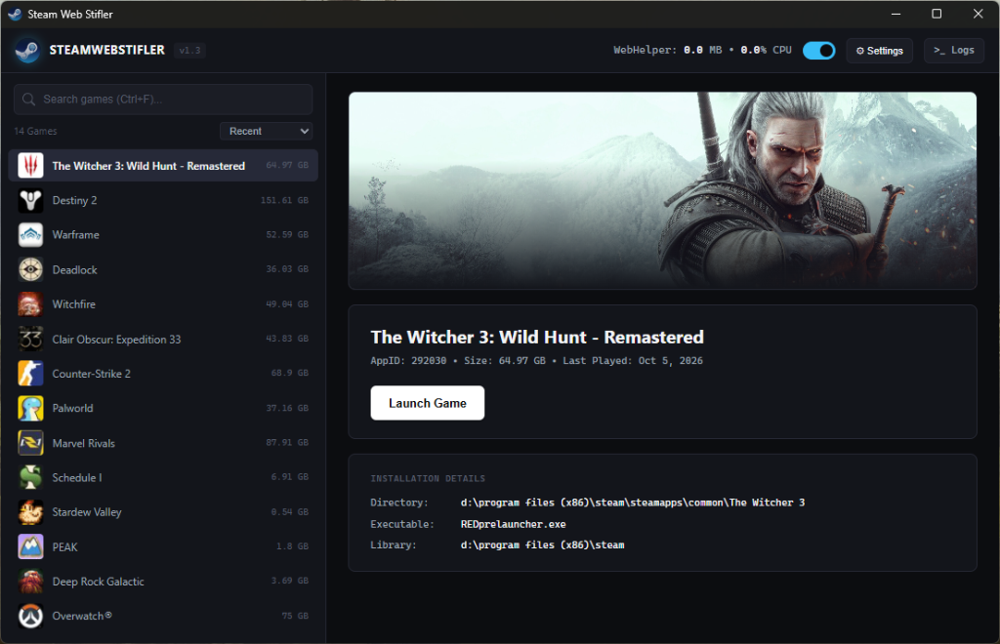

<div align="center">

  

  # SteamWebStifler

  **Tame Steam's bloated `steamwebhelper` processes and reclaim your system memory.**

  [](https://github.com/Lukas-Brink/SteamWebStifler/releases)
  [](https://www.microsoft.com/windows)
  [](https://www.python.org/)
  [](LICENSE)
  [](#about-this-project)

</div>

---

> [!NOTE]
> ### 🤖 About This Project
> **SteamWebStifler was coded and architected almost entirely using AI** (via Google DeepMind's Antigravity pair-programming agent). It was developed to solve a real-world edge case: after activating thousands of free Steam packages, Steam's Chromium-based `steamwebhelper` memory footprint and CPU utilization ballooned out of control, causing client freezes and degraded gaming performance.

---

## 📸 Interface Preview

<div align="center">
  
</div>

---

## 🌟 Overview & Why SteamWebStifler?

Steam's Chromium Embedded Framework (CEF) client (`steamwebhelper.exe`) frequently consumes gigabytes of RAM across multiple background rendering and utility processes—especially on accounts with extensive game libraries.

**SteamWebStifler** gives you full control over Steam's webhelper processes without breaking your games:
* **Suspends and trims memory** down to near **0.0 MB** and **0.0% CPU** when you are browsing or playing.
* **Intelligent Launch Pipeline**: Automatically thaws/resumes `steamwebhelper` right before launching a game so cloud saves, DRM, Steamworks handshakes, and achievements work seamlessly—then re-stifles once the game is running.
* **Built-in Game Library Launcher**: Fast, clean desktop command center that indexes installed games across all Steam library drives and launches them instantly.

---

## ⚠️ Important Notice

> [!WARNING]
> While `steamwebhelper` is stifled (suspended), the built-in graphical interface of the official Steam client (Store, Community, Chat, and Library web views) will be paused and will not render.
> 
> * Games launch and play completely normally.
> * If you need to access the Steam Store, Steam Chat, or Community tabs, simply flip the toggle in SteamWebStifler to un-stifle at any time!

---

## ✨ Features

- 🛑 **Deep Win32 Process Control**: Uses low-level `ntdll.NtSuspendProcess` and `psapi.EmptyWorkingSet` to aggressively reclaim memory without killing Steam.
- 🚀 **Intelligent 3-Stage Launch Pipeline**:
  1. **Pre-Launch Thaw**: Resumes `steamwebhelper` so Steamworks handshakes and cloud sync succeed.
  2. **Process Watcher**: Monitors the game process lifecycle until it successfully initializes.
  3. **Post-Launch Freeze**: Automatically re-stifles `steamwebhelper` to maximize FPS and free resources for your game.
- 🎮 **Universal Library Scanner**: Parses official Steam `.acf` manifests across all configured library drives with instant search and sorting.
- 🖼️ **High-Resolution Asset Caching**: Automatically downloads and caches official Steam CDN hero banners and square icons locally.
- 🪟 **Modern Matte Dark UI**: Sleek, responsive interface built with Microsoft Edge WebView2 (`pywebview`) and vanilla CSS.
- 🔔 **System Tray & Single Instance**: Minimizes cleanly to the Windows notification tray, prevents duplicate instances via Win32 named mutexes, and supports Windows startup toggle.
- 📜 **Integrated Diagnostics**: Embedded real-time log drawer with 1-click clipboard copy and direct log file opening.

---

## 📥 Download

Pre-compiled standalone executables are available on the [**Releases**](https://github.com/Lukas-Brink/SteamWebStifler/releases) page.
- No Python installation required.
- Single portable `.exe` file (~37 MB) with embedded WebView2 UI and assets.

---

## 🛠️ Running from Source

### Prerequisites
* Windows 10 or 11 (64-bit)
* Python 3.10 or higher
* [Microsoft Edge WebView2 Runtime](https://developer.microsoft.com/en-us/microsoft-edge/webview2/) (pre-installed on Windows 10/11)

### Installation
1. Clone the repository:
   ```cmd
   git clone https://github.com/Lukas-Brink/SteamWebStifler.git
   cd SteamWebStifler
   ```

2. Install dependencies:
   ```cmd
   pip install -r requirements.txt
   ```

3. Run the application:
   ```cmd
   python main.py
   ```
   *(Or double-click `start.bat`)*

#### Command Line Options
* `--tray` or `--minimized`: Launch directly into the system tray.

---

## 📦 Building Standalone Executable

To compile your own single-file portable executable using PyInstaller:

```cmd
build_exe.bat
```

The output binary will be generated at `SteamWebStifler.exe` (or in `dist/SteamWebStifler.exe`).

---

## 🏛️ Project Architecture

```
SteamWebStifler/
├── assets/                # Repository assets (logo, preview screenshots)
│   ├── logo.png
│   └── screenshot.png
├── gui/                   # Modern WebView2 frontend
│   ├── app.js             # Frontend reactive logic & API bridge
│   ├── favicon.ico        # Window and webview favicon
│   ├── index.html         # Application layout & component tree
│   ├── logo.png           # UI header branding asset
│   └── style.css          # Dark theme styles & responsive rules
├── app_icon.ico           # Windows application icon
├── build_exe.bat          # 1-Click PyInstaller compilation script
├── engine.py              # Win32 process supervisor & Steam library parser
├── image_cache.py         # Steam CDN banner & icon caching engine
├── main.py                # Process entrypoint & single-instance mutex
├── paths.py               # Portable path resolver & runtime director
├── requirements.txt       # Minimal Python dependencies
├── settings_manager.py    # Persistent user config & Windows startup registry
├── start.bat              # Quick Python launcher script
├── SteamWebStifler.spec   # PyInstaller bundle specification
└── data/                  # Local runtime directory (auto-created, git-ignored)
    ├── cache/             # Banner and icon image caches
    ├── config.json        # User preferences
    ├── steamwebstifler.log# Diagnostic logs
    └── webview/           # Isolated WebView2 profile storage
```

---

## 📄 License

This project is licensed under the [MIT License](LICENSE).
